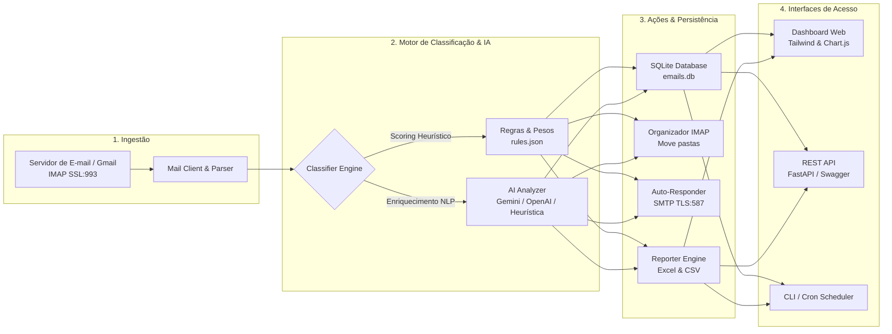

# AutoMail AI — Enterprise Email Automation & Triage Engine

[](https://www.python.org/)
[](https://fastapi.tiangolo.com/)
[](https://www.sqlite.org/)
[](#arquitetura-do-sistema)
[](LICENSE)

Solução corporativa em Python para ingestão, triagem, categorização semântica e despacho automatizado de e-mails em escala. Projetada para reduzir o SLA de atendimento comercial e organizar fluxos operacionais internos de empresas, integrando-se nativamente a servidores **Gmail (Google Workspace)** e **servidores de e-mail corporativos (IMAP/SMTP)**.

---

## 📌 Sumário Executivo

Em ambientes empresariais, caixas de entrada compartilhadas e e-mails de contato recebem centenas de mensagens diárias misturando orçamentos urgentes, notificações financeiras, comunicados internos e spam. A triagem manual gera gargalos, atrasos em propostas comerciais e perda de leads.

O **AutoMail AI** automatiza esse fluxo de ponta a ponta:
1. **Conexão Segura**: Monitora caixas postais via protocolos padrão da indústria (IMAP/SSL).
2. **Triagem Híbrida**: Classifica mensagens entre Comercial, Corporativo/Interno, Financeiro, Suporte e Marketing via scoring de palavras-chave, regex e inferência por IA.
3. **Extração de Entidades**: Identifica urgência (Alta/Média/Baixa), cifras monetárias em R$ e gera resumos executivos em uma linha.
4. **Organização no Servidor**: Cria pastas no servidor e move mensagens para seus respectivos departamentos.
5. **Auto-Reply para Leads**: Confirmação profissional imediata para solicitações comerciais com proteção anti-duplicação.
6. **Visibilidade Operacional**: Dashboard web em tempo real e relatórios executivos em Excel (`.xlsx`).

---

## 🏗️ Arquitetura do Sistema



---

## ⚙️ Funcionalidades Centrais

| Componente | Descrição Técnica |
|---|---|
| **Pipeline de Classificação** | Algoritmo determinístico ponderado com pesos distintos para assunto, corpo e domínios corporativos, com normalização diacrítica (remove acentuação). |
| **Enriquecimento por IA** | Extrai valor monetário, resumo de uma frase, nome da entidade contratante e classifica urgência. Opera com Google Gemini, OpenAI ou motor heurístico offline em caso de indisponibilidade de rede. |
| **Resposta Automática Comercial** | Envia templates profissionais personalizáveis para mensagens comerciais, validando listas de supressão (`no-reply`, `bounce`, contas internas) e evitando loops. |
| **Persistência & Métricas** | Banco de dados transacional SQLite com controle de concorrência (`contextlib`), métricas agrupadas e histórico auditável. |
| **Painel Web Unificado** | Dashboard responsivo com gráficos de distribuição por departamento, monitoramento de urgência, testador interativo de textos e download direto de relatórios. |
| **API RESTful** | Endpoints documentados via OpenAPI 3.0 / Swagger UI para acionamento remoto por ERPs, CRMs ou esteiras de CI/CD. |
| **Modo Dry-Run (Auditoria)** | Permite simulação prévia completa de fluxos sem alterar o estado do servidor de e-mail. |

---

## 📁 Estrutura do Repositório

```
├── api/
│   ├── __init__.py
│   └── app.py                  # API REST FastAPI e rotas de integração
├── config/
│   ├── __init__.py
│   ├── settings.py             # Gerenciamento de variáveis de ambiente
│   └── rules.json              # Dicionário de regras, pesos e categorias
├── core/
│   ├── __init__.py
│   ├── ai_analyzer.py          # Módulo de inteligência artificial e NLP
│   ├── auto_reply.py           # Motor de resposta automática SMTP
│   ├── classifier.py           # Mecanismo de pontuação e categorização
│   ├── database.py             # Camada de persistência SQLite
│   ├── mail_client.py          # Cliente IMAP4 SSL com decoding MIME
│   ├── organizer.py            # Orquestrador do pipeline de dados
│   └── reporter.py             # Gerador de relatórios Excel (.xlsx) e CSV
├── logs/                       # Logs estruturados de execução
├── relatorios/                 # Artefatos exportados (.xlsx, .csv)
├── web/
│   └── dashboard.html          # Interface gráfica do Dashboard
├── .env.example                # Modelo de parametrização
├── .gitignore                  # Regras de exclusão do Git
├── main.py                     # Ponto de entrada (CLI e servidor)
├── requirements.txt            # Dependências Python
├── test_connection.py          # Diagnóstico de conectividade de rede/IMAP
└── test_system_offline.py      # Suíte de testes unitários automatizados
```

---

## 🚀 Instalação e Execução

### 1. Pré-requisitos
- Python 3.10 ou superior
- Pip gerenciador de pacotes

### 2. Clonar o Repositório e Instalar Dependências

```bash
git clone https://github.com/Matheusg0ulart/API-automa-o-email.git
cd API-automa-o-email

# Criação e ativação do ambiente virtual (recomendado)
python -m venv venv
# No Windows:
.\venv\Scripts\activate
# No Linux/Mac:
source venv/bin/activate

# Instalar dependências
pip install -r requirements.txt
```

### 3. Configuração do Arquivo `.env`

Copie o arquivo de exemplo e configure suas credenciais:

```bash
cp .env.example .env
```

Parâmetros principais:

```env
# Credenciais do Provedor de E-mail
EMAIL_USER=seu_email@empresa.com.br
EMAIL_PASSWORD=sua_senha_ou_senha_de_app
IMAP_SERVER=imap.gmail.com
IMAP_PORT=993

# Parâmetros Operacionais
MAILBOX_SOURCE=INBOX
ONLY_UNREAD=True
DRY_RUN=True
COMPANY_DOMAIN=suaempresa.com.br
MAX_EMAILS_PER_RUN=50

# Inteligência Artificial (Opcional - opera em modo heurístico local se vazio)
GEMINI_API_KEY=
OPENAI_API_KEY=

# Resposta Automática Comercial (Opcional)
ENABLE_AUTO_REPLY=False
SMTP_SERVER=smtp.gmail.com
SMTP_PORT=587

# Servidor Web
WEB_HOST=127.0.0.1
WEB_PORT=8000
```

> **Configuração para Gmail**: O Google exige a criação de uma **Senha de Aplicativo (16 caracteres)**. Acesse `Gerenciar Conta Google` > `Segurança` > `Verificação em 2 etapas` > `Senhas de app`. No Gmail Web, certifique-se de que o **Acesso IMAP** está ativo em `Configurações` > `Encaminhamento e POP/IMAP`.

---

## 💻 Modos de Uso

### 1. Painel Web & API REST (Dashboard)

Inicia o servidor Uvicorn com documentação Swagger integrada:

```bash
python main.py --web
```

Acesse:
- **Dashboard Operacional**: `http://localhost:8000`
- **Documentação OpenAPI / Swagger**: `http://localhost:8000/docs`

### 2. Menu Interativo (CLI)

Ideal para operadores e tarefas sob demanda:

```bash
python main.py
```

### 3. Execução Direta / Agendamento (Cron / Windows Task Scheduler)

```bash
# Executar triagem e mover e-mails no servidor
python main.py --run

# Simulação sem alterar dados no servidor
python main.py --dry-run

# Monitoramento contínuo em background (a cada 10 minutos)
python main.py --monitor --interval 10

# Testar conectividade com o servidor IMAP
python main.py --test
```

---

## 🔌 Referência da API REST

| Método | Endpoint | Descrição |
|---|---|---|
| `GET` | `/` | Interface visual do Dashboard |
| `GET` | `/api/dashboard-data` | Retorna métricas consolidadas, contagens por departamento e últimos e-mails |
| `POST` | `/api/processar` | Aciona o processamento da caixa postal (`?dry_run=true&limit=20`) |
| `POST` | `/api/classificar-texto` | Recebe payload JSON de assunto e corpo para classificação sob demanda |
| `GET` | `/api/relatorios` | Lista as planilhas Excel geradas com metadados de criação e tamanho |
| `GET` | `/api/relatorios/download/{arquivo}` | Download seguro de relatório `.xlsx` ou `.csv` |
| `GET` | `/api/status` | Retorna o status de conexão, autenticação e provedores ativos |

---

## 🧪 Testes Automatizados

O projeto inclui suíte de testes unitários isolados que validam normalização de strings, regras de categorização, heurística de NLP, operações transacionais do SQLite e contratos da API:

```bash
python test_system_offline.py
```

Resultado esperado:
```text
Ran 12 tests in 0.5s
OK
```

---

## 🔒 Segurança & Boas Práticas

- **Segregação de Credenciais**: Senhas e tokens de API trafegam exclusivamente por variáveis de ambiente via `.env`, expressamente ignoradas no controle de versão (`.gitignore`).
- **Comunicação Criptografada**: Todas as conexões de rede operam com TLS/SSL (IMAP: 993, SMTP: 587/465).
- **Proteção de Dados**: O banco SQLite armazena metadados de triagem localmente, sem envio de conteúdo para servidores de telemetria externos.
- **Fail-Safe**: Em caso de falha de conexão com APIs de LLMs, o sistema aciona fallback determinístico sem interromper a rotina de triagem.

---

## 📄 Licença

Distribuído sob a licença MIT. Consulte `LICENSE` para mais informações.
